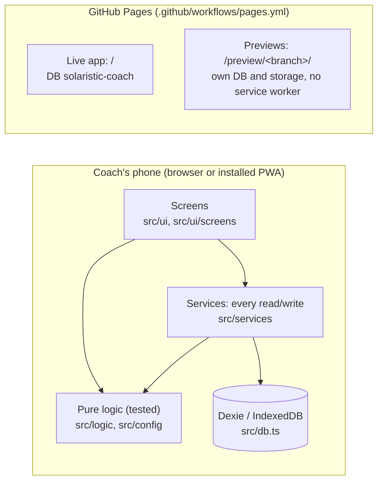

# Architecture

Solaristic Coach is an offline-first web app (Preact + TypeScript, built with Vite) installable as a PWA. Every record is saved on the device in IndexedDB (Dexie). There are no accounts, no sync and no network requests at runtime in round 1. Capacitor (Android) comes later, as in Radar.

## Main parts



- **Screens** (`src/ui/screens/`): one file per screen. Shared pieces in `src/ui/` (`components.tsx`, `Field.tsx` field drawings, `Swipe.tsx` swipe cards, `dragDrop.ts`, `hooks.ts`). Routing is a hash router in `src/ui/App.tsx` (the route list is at the top of that file).
- **Logic** (`src/logic/`): pure functions, no database. `gameTime.ts` (clock, subs, minutes, suggestions), `lineup.ts` (Fair rotation, bench plan), `teamBuilder.ts`, `season.ts` (season numbers, who needs attention, team list), `drills.ts`, `backupCrypto.ts`, `swipe.ts`, `random.ts` (seeded).
- **Config** (`src/config/`): `sports.ts` (templates), `coaching.ts` (age groups, rating areas, thresholds), `drills.ts` (library).
- **Services** (`src/services/`): every database read and write, re-exported by `index.ts` (`import * as svc from '../services'`).
- **Database** (`src/db.ts`): Dexie schema (v1), `TABLES` for backups, settings helpers. `useDatabase()` swaps the instance (tests).
- **Previews** (`src/preview.ts`): a branch build (`VITE_PREVIEW=<branch>`) gets its own database name and storage keys, and `vite.config.ts` turns the service worker off.
- **Demo** (`src/demo.ts`): the fictional U11 soccer team, seeded so it is the same every time.

## Data model (round 1)

| Table | What | Key fields |
|---|---|---|
| teams | a team for one season | name, sportId, overrides (onField, periods, periodMinutes), season, ageGroup, kind |
| players | squad members | teamId, firstName, lastInitial, jersey?, positions[], active |
| events | a training or a game | teamId, kind, date, openedAt, closedAt?, opponent, venue, gameType, score, clock, lineup, drillIds |
| attendance | one tap per player per event | eventId, playerId, status (here / late / away) |
| stints | one spell on the field in one position | eventId, playerId, positionId, period, start, end (game-clock ms) |
| ratings | coach-only quick ratings | eventId, playerId, scores {area: 1 / -1}, note? |
| drillUses | a drill used at a training | eventId, drillId, result (worked / didnt) |
| settings | one row | coachName, swipeAnimations, lastTeamId |

## How fair game time works

```mermaid
sequenceDiagram
  participant C as Coach
  participant L as LiveGame screen
  participant S as services/game.ts
  participant G as logic/gameTime.ts
  participant D as Dexie
  C->>L: Start the game
  L->>S: kickOff(): starting line-up becomes open stints at 0 ms, clock starts
  C->>L: tap bench player, then a spot
  L->>S: sub(eventId, positionId, playerIn)
  S->>G: gameMs(clock, now), substitute(stints…)
  S->>D: one transaction: close the old stint, open the new one
  L->>G: minutesByPlayer(), suggestSubs() every second while running
  C->>L: End quarter / End game
  S->>D: clock.done gets the period length; at the end every open stint closes
```

- Time is measured on the **game clock**, not the wall clock: pausing (injury, drinks break, quarter time) stops minutes for everyone.
- Minutes always add up: total player-minutes = game minutes × players on the field (less only if a spot was left empty). The live screen shows this check, and the tests prove it.
- Season minutes only count **closed** games.

## Stack

Same as Radar (see `docs/DECISIONS.md` for why): Preact, TypeScript 7, Vite 8, Dexie 4, vite-plugin-pwa, Vitest + fake-indexeddb, ESLint 9 + Prettier (in `tools/lint/`). Capacitor later.

## Further reading

- `docs/DEVELOPING.md`: setup, commands, tests, database versions
- `docs/DECISIONS.md`, `docs/REUSED_FROM_RADAR.md`
- `docs/PRODUCT_SPEC.md`
